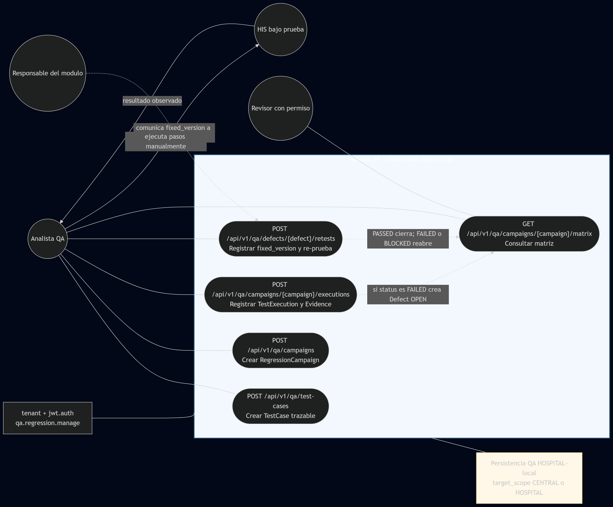
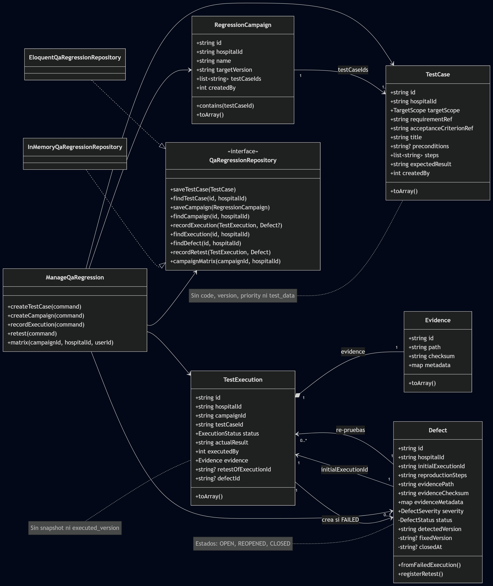
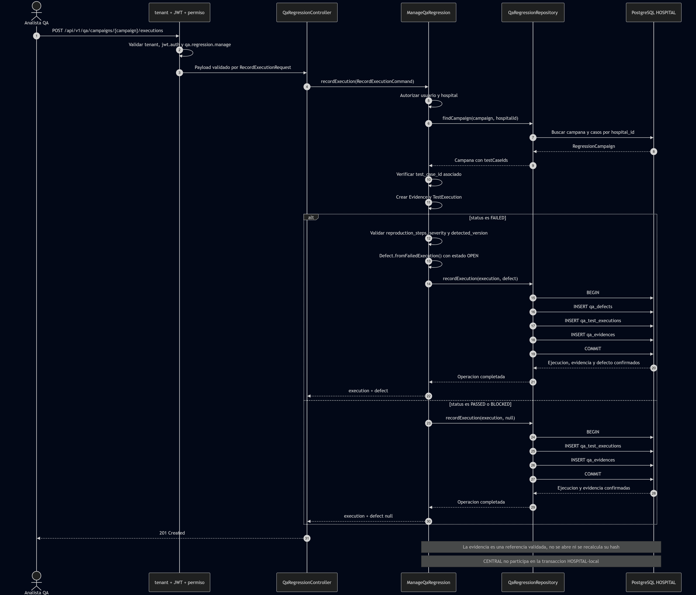
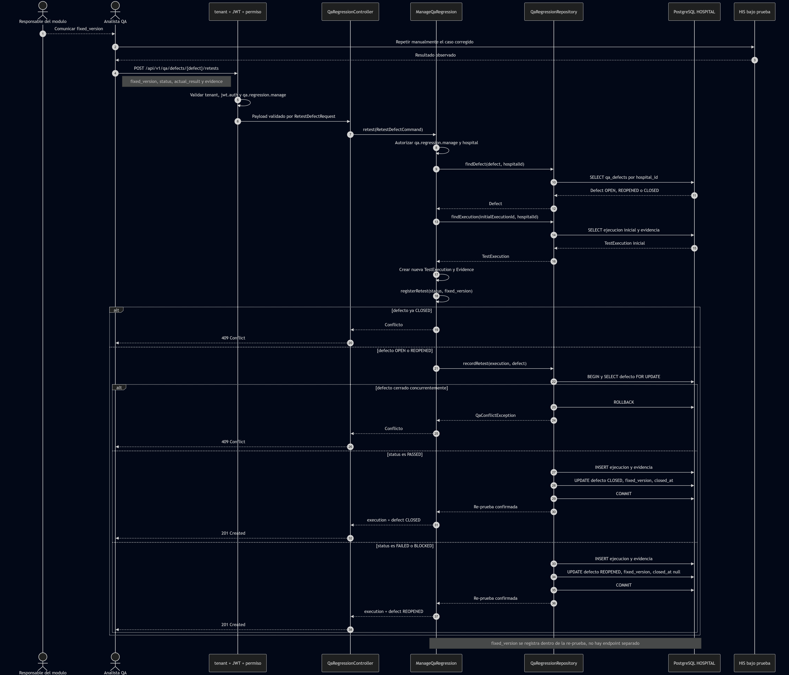
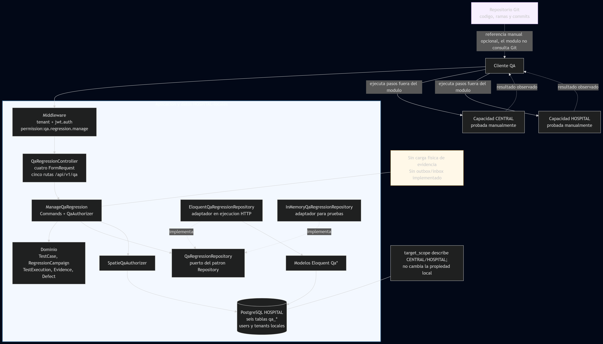
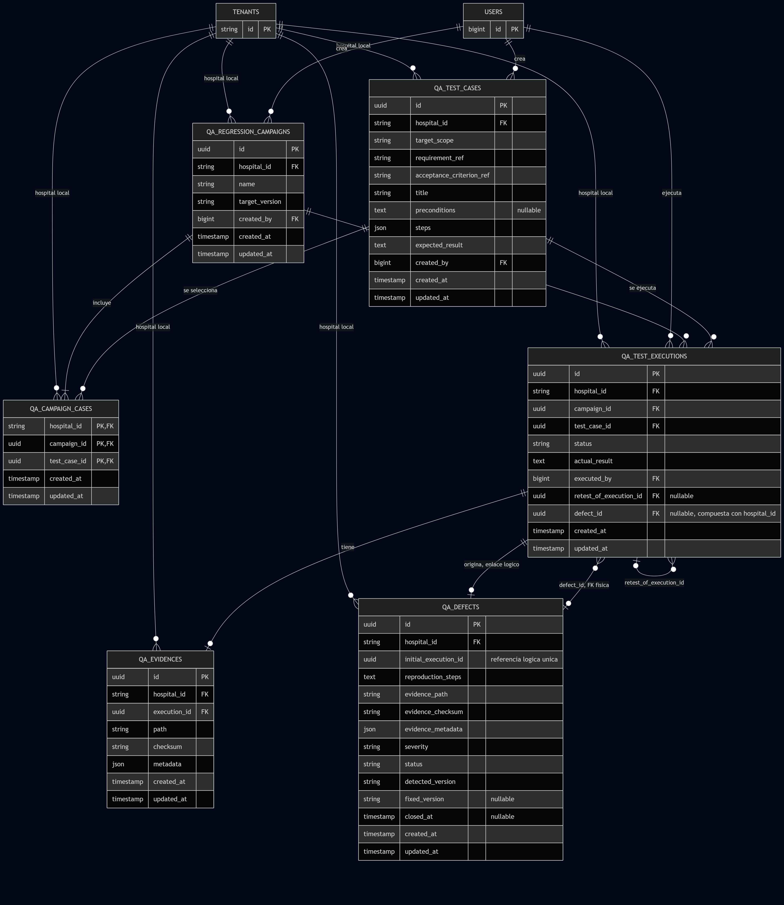

# Evidencia reproducible - Módulo 29

## 1. Identificación del corte

| Dato | Valor verificado |
|---|---|
| Estudiante | Didhyer Alexander Ortiz Guevara |
| Usuario GitHub | `DidhyerOrtiz` |
| Asignación | Variante `mod29`, antecedente histórico issue `#28` |
| Worktree | `C:\Users\didhy\OneDrive\Escritorio\Analisis\shi-mod29-qa-regresion` |
| Rama | `feat/mod29-qa-regresion` |
| Base remota | `origin/develop` en `0050f4f` |
| Tip de código/pruebas antes de commits de evidencia | `80f8f37` |
| Corte reforzado de semana 4 | Entrega final preparada a partir de `f52d969` |
| Diferencia con la base | 12 commits previos más el corte final de entrega |
| Fecha de verificación final | 2026-09-13 |

Los documentos de evidencia iniciales se prepararon después de verificar `80f8f37`. La revisión final del 13 de septiembre reforzó atomicidad del adaptador InMemory, unicidad de evidencia, índices y cobertura PostgreSQL, e incorporó los seis renderizados y el informe entregable.

Comandos de identificación:

```powershell
git branch --show-current
git rev-parse --short origin/develop
git rev-parse --short HEAD
git rev-list --count origin/develop..HEAD
git status --short --branch
```

El corte inicial de código fue `80f8f37` con 10 commits sobre la base. La entrega reforzada parte de `f52d969` y agrega las correcciones verificadas, los seis PNG y los informes finales.

## 2. Entorno

| Componente | Versión / condición |
|---|---|
| PHP CLI | 8.3.31 |
| Laravel Framework | 12.58.0 |
| PHPUnit | 11.5.55 |
| PostgreSQL | 17, imagen `postgres:17-alpine` |
| Contenedor | `shi-mod29-postgres`, aislado, puerto local 55429 |
| Base destructible | `shi_mod29_test` |
| Sistema de comandos | Windows PowerShell |

La ejecución real usó credenciales efímeras y ficticias del contenedor Docker. No eran credenciales institucionales, no daban acceso a datos reales y no fueron incorporadas al repositorio. En los comandos siguientes el usuario y la contraseña aparecen deliberadamente como marcadores.

## 3. Preparación segura de PostgreSQL

Ejemplo reproducible para crear el contenedor si no existe. Se deben reemplazar los marcadores localmente; no deben registrarse en Git:

```powershell
docker run --name shi-mod29-postgres `
  -e POSTGRES_DB=shi_mod29_test `
  -e POSTGRES_USER='<USUARIO_QA_FICTICIO>' `
  -e POSTGRES_PASSWORD='<CONTRASENA_EFIMERA_NO_REAL>' `
  -p 55429:5432 `
  -d postgres:17-alpine
```

Variables usadas por la prueba de integración:

```powershell
$env:QA_PG_HOST = '127.0.0.1'
$env:QA_PG_PORT = '55429'
$env:QA_PG_DATABASE = 'shi_mod29_test'
$env:QA_PG_USERNAME = '<USUARIO_QA_FICTICIO>'
$env:QA_PG_PASSWORD = '<CONTRASENA_EFIMERA_NO_REAL>'
$env:QA_PG_SSLMODE = 'prefer'
$env:QA_PG_ALLOW_MIGRATE_FRESH = '1'
```

Hay dos salvaguardas obligatorias en `PostgreSqlQaRepositoryIntegrationTest`: `QA_PG_DATABASE` debe terminar en `_test` y `QA_PG_ALLOW_MIGRATE_FRESH` debe valer exactamente `1`. Si alguna condición falta, la prueba destructiva se omite. La base `shi_mod29_test` satisface el sufijo y está dedicada a QA.

## 4. Evidencia automatizada

### 4.1 Versiones

```powershell
php -v
php artisan --version
php -d extension=pdo_pgsql vendor/bin/phpunit --version
```

Salida resumida verificada:

```text
PHP 8.3.31
Laravel Framework 12.58.0
PHPUnit 11.5.55
```

### 4.2 Suite del Módulo 29

Con las variables `QA_PG_*` de la sección anterior:

```powershell
php -d extension=pdo_pgsql vendor/bin/phpunit tests/Unit/Modulo29 tests/Feature/Modulo29
```

Salida resumida:

```text
..................... 21 / 21 (100%)
OK (21 tests, 63 assertions)
```

El total incluye 7 pruebas de dominio, 6 de aplicación con repositorio en memoria, 6 HTTP y 2 de integración sobre PostgreSQL real. Las pruebas PostgreSQL aportan 13 aserciones y validan persistencia atómica, rollback ante membresía inválida, re-prueba, cierre, matriz, aislamiento de lectura y la restricción de una evidencia por ejecución.

### 4.3 Regresión del Módulo 20

```powershell
php -d extension=pdo_pgsql vendor/bin/phpunit tests/Unit/Modulo20 tests/Feature/Modulo20
```

Salida resumida:

```text
............. 13 / 13 (100%)
OK (13 tests, 30 assertions)
```

Esta ejecución comprueba que el vertical agregado no introdujo una regresión observable en el Módulo 20 disponible en la base de la rama.

### 4.4 Migración completa y seeders en PostgreSQL

Laravel usa variables `DB_*`; el modelo `Tenant` de Stancl usa además la conexión `central`. Para que ambas apunten exclusivamente a la misma base de prueba:

```powershell
$env:DB_CONNECTION = 'pgsql'
$env:DB_HOST = $env:QA_PG_HOST
$env:DB_PORT = $env:QA_PG_PORT
$env:DB_DATABASE = $env:QA_PG_DATABASE
$env:DB_USERNAME = $env:QA_PG_USERNAME
$env:DB_PASSWORD = $env:QA_PG_PASSWORD

$env:CENTRAL_DB_CONNECTION = 'pgsql'
$env:CENTRAL_DB_HOST = $env:QA_PG_HOST
$env:CENTRAL_DB_PORT = $env:QA_PG_PORT
$env:CENTRAL_DB_DATABASE = $env:QA_PG_DATABASE
$env:CENTRAL_DB_USERNAME = $env:QA_PG_USERNAME
$env:CENTRAL_DB_PASSWORD = $env:QA_PG_PASSWORD

php -d extension=pdo_pgsql artisan migrate:fresh --seed --force
```

Resultado: **PASS**. Se eliminaron y recrearon las tablas de `shi_mod29_test`; las 12 migraciones terminaron en `DONE`, incluida `2026_08_21_000029_create_qa_regression_tables`. También terminaron en `DONE` `RoleSeeder`, `TenantSeeder`, `MedicationCatalogSeeder` y `DemoDataSeeder2026`.

### 4.5 Calidad de diff y formato

```powershell
git diff --check
```

Resultado: **PASS**, sin errores de espacios ni marcadores conflictivos.

La comprobación focal de formato del módulo se ejecutó por separado:

```powershell
php vendor/bin/pint --test app/Domain/Modulo29 app/Application/Modulo29 app/Infrastructure/Modulo29 app/Http/Controllers/Api/V1/QaRegressionController.php app/Http/Requests/Modulo29 tests/Unit/Modulo29 tests/Feature/Modulo29 database/migrations/2026_08_21_000029_create_qa_regression_tables.php
```

Resultado: **PASS** (`pint: passed`). Una ejecución de Pint sobre todo el repositorio reporta deuda de formato heredada fuera del Módulo 29. Ese resultado global no significa que Modulo29 haya fallado y no se corrigieron archivos ajenos como parte de esta asignación.

## 5. Rutas verificadas

Las cinco rutas están registradas bajo `/api/v1/qa` y aplican JWT, resolución de tenant y permiso `qa.regression.manage`:

```powershell
php artisan route:list --path=api/v1/qa
```

| Método | Ruta | Propósito |
|---|---|---|
| POST | `/api/v1/qa/test-cases` | Crear un caso trazable. |
| POST | `/api/v1/qa/campaigns` | Crear una campaña con casos del hospital. |
| POST | `/api/v1/qa/campaigns/{campaign}/executions` | Registrar ejecución y evidencia; crear defecto si falla. |
| POST | `/api/v1/qa/defects/{defect}/retests` | Registrar una re-prueba y versión corregida. |
| GET | `/api/v1/qa/campaigns/{campaign}/matrix` | Consultar la matriz consolidada. |

## 6. Árbol de archivos relevante

```text
app/
├── Application/Modulo29/
│   ├── Authorization/QaAuthorizer.php
│   ├── Commands/{CreateCampaign,CreateTestCase,RecordExecution,RetestDefect}Command.php
│   ├── Exceptions/QaForbiddenException.php
│   └── UseCases/ManageQaRegression.php
├── Domain/Modulo29/
│   ├── Entities/{Defect,Evidence,RegressionCampaign,TestCase,TestExecution}.php
│   ├── Enums/{DefectSeverity,DefectStatus,ExecutionStatus,TargetScope}.php
│   ├── Exceptions/{QaConflict,QaNotFound,QaValidation}Exception.php
│   └── Repositories/QaRegressionRepository.php
├── Http/
│   ├── Controllers/Api/V1/QaRegressionController.php
│   └── Requests/Modulo29/{CreateCampaign,CreateTestCase,RecordExecution,RetestDefect}Request.php
└── Infrastructure/Modulo29/
    ├── Authorization/SpatieQaAuthorizer.php
    └── Persistence/{EloquentQaRegressionRepository,InMemoryQaRegressionRepository}.php
database/
└── migrations/2026_08_21_000029_create_qa_regression_tables.php
docs/modulos/mod29/
├── ADR-001-arquitectura.md
├── ESPECIFICACION.md
├── README.md
├── *.mmd (seis fuentes Mermaid)
├── *.png (seis renderizados finales incorporados)
├── DECLARACION_IA.md
├── EVIDENCIA.md
├── MATRIZ_REGRESION.md
├── informe-tarea-repository.md
├── informe-tarea-repository.docx (informe final editable)
└── informe-tarea-repository.pdf (informe final para entrega)
routes/api.php
tests/
├── Feature/Modulo29/{ManageQaRegression,PostgreSqlQaRepositoryIntegration,QaRegressionHttp}Test.php
└── Unit/Modulo29/QaDomainTest.php
```

Los seis modelos Eloquent residen en `app/Infrastructure/Modulo29/Persistence/Models` y corresponden a las seis tablas `qa_*`.

## 7. Historial sustantivo

Comando:

```powershell
git log --format='%h %s' origin/develop..80f8f37
```

Salida de los 10 commits en el corte de código `80f8f37`, del más reciente al más antiguo:

```text
80f8f37 test(mod29): cubre API y PostgreSQL real
6faad04 test(mod29): valida dominio y aplicacion QA
b07e8eb feat(mod29): expone API de campanas QA
033fd48 feat(mod29): integra permisos y dependencias QA
0e5aa7c feat(mod29): persiste regresion en PostgreSQL
64a1b1d feat(mod29): agrega repositorios Eloquent e InMemory
487785a feat(mod29): orquesta casos de uso QA
ec0742a feat(mod29): implementa dominio de regresion QA
100e01c docs(mod29): modela arquitectura y trazabilidad
e524a9e docs(mod29): especifica flujo vertical QA
```

## 8. Evidencia manual

La evidencia manual se distingue de las aserciones automatizadas. Consistió en:

- contrastar las cinco rutas en `routes/api.php` con el controlador y los cuatro `FormRequest`;
- revisar que `hospital_id` provenga del contexto autenticado y que las consultas del Repository se filtren por hospital;
- inspeccionar transacciones de campaña, ejecución fallida y re-prueba;
- verificar que la validación de metadatos sea recursiva y rechace claves sensibles;
- comparar especificación, ADR, fuentes Mermaid, migración, repositorios y pruebas para retirar afirmaciones no respaldadas;
- comprobar rama, base, tip, historial y estado del worktree;
- registrar el defecto prepublicación `QA-DEF-001` y su re-prueba sin ocultar el resultado inicial.

Esta revisión no equivale a una prueba exploratoria de interfaz: el módulo no incluye UI. Los escenarios funcionales ejecutados están automatizados a nivel de dominio, aplicación, HTTP y PostgreSQL.

## 9. Seguridad y privacidad

- Se usaron tenants, usuarios, correos y contraseñas ficticios de prueba.
- No se usaron nombres, historias clínicas, identificadores ni archivos de pacientes reales.
- Las credenciales efímeras del contenedor no se escribieron en documentación ni se agregaron a Git.
- `hospital_id` y el usuario ejecutor derivan del contexto autenticado, no del JSON cliente.
- Las rutas exigen JWT, tenant y `qa.regression.manage`.
- La evidencia declarada debe usar `private/qa/`, checksum SHA-256 y `metadata.redacted=true`.
- Se rechazan recursivamente las claves `password`, `token`, `authorization`, `cookie` y `secret`.
- El aislamiento por hospital se cubrió tanto en aplicación como en HTTP.

## 10. Limitaciones

- La API guarda la referencia de evidencia, su checksum declarado y metadatos; no carga, abre ni verifica físicamente el archivo.
- No hay versionado ni snapshots de casos.
- No hay outbox, idempotencia ni sincronización CENTRAL/HOSPITAL.
- La matriz no promete una instantánea transaccional global de sus varias lecturas.
- No se ejecutó automatización E2E de una UI porque no existe una UI en el alcance.
- El PASS de Modulo20 es una regresión focal, no una afirmación de que toda la aplicación carece de deuda preexistente.
- Pint global conserva deuda heredada fuera del Módulo 29; Pint focal del módulo sí pasó.
- El ciclo ejecución/defecto se resuelve con `qa_defects.initial_execution_id` como enlace lógico único y una FK compuesta `(hospital_id, defect_id)` desde la ejecución hacia el defecto; la transacción inserta ambos registros o revierte todo.

## 11. Renderizados PNG finales

Las seis fuentes superaron validación de sintaxis mediante Kroki Mermaid el 13 de septiembre de 2026. Los renderizados finales se incorporaron con los siguientes nombres y se revisaron visualmente:













Las fuentes verificadas son `casos-de-uso.mmd`, `diagrama-clases.mmd`, `secuencia-ejecucion.mmd`, `secuencia-defecto-reprueba.mmd`, `componentes.mmd` y `vista-datos.mmd`. Los PNG conservan el contenido de esas fuentes y no contienen datos clínicos ni credenciales.
